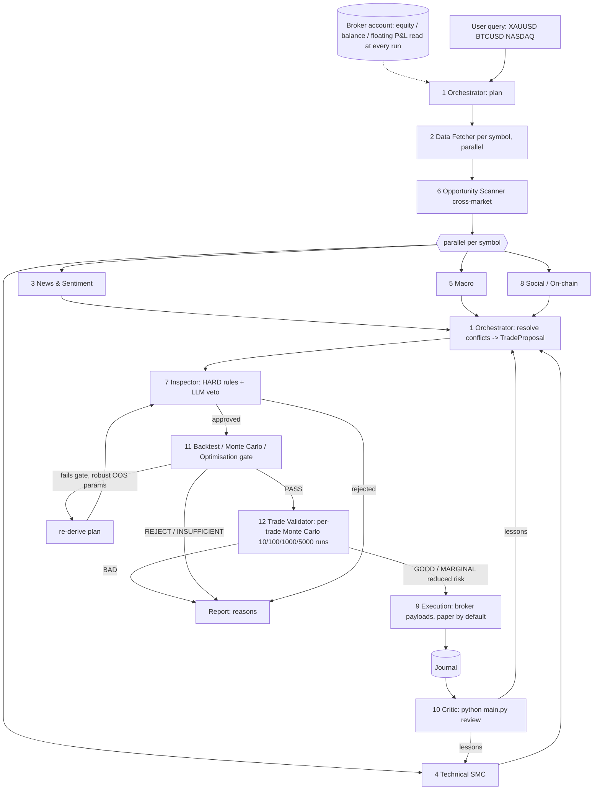

# Architecture

## Stages (see `swarm/pipeline.py`)
0. `accounts.resolve_account` - reads the linked broker (or the paper simulator) and the equity snapshots: equity, day/week P&L incl. floating, drawdown. The run stops if a linked broker cannot be read.
1. `Orchestrator.plan` - deterministic routing (which agents / timeframes / social mode per asset class).
2. `DataFetcher` - parallel per symbol; hard-fails symbols with unusable data.
3. `Scanner` - one cross-market call over the whole watchlist.
4. News, Technical, Macro, Social - all (symbol x agent) jobs run in a thread pool.
5. `Orchestrator.decide` - conflict resolution; guardrail: news freeze forces WAIT.
6. `Inspector` -> `Backtester` gate -> `TradeValidator` - sequential, highest confidence first, so total open risk is accounted correctly (correlated assets).
7. `Execution` - only for trades that passed Inspector, the Backtest gate AND the Trade Validator.
8. Journal + executive summary; Critic closes the loop later.

## Data contracts
Every agent returns a validated Pydantic object (`swarm/schemas.py`). The LLM wrapper (`swarm/llm.py`) asks for JSON matching the schema, extracts the last JSON object, validates, and retries once with the validation error.

## Why heuristics?
Each agent has a rule-based `heuristic()`: powers `--demo` / `--no-llm`, and is the fallback when an LLM call fails. A failed LLM => Inspector rejects (never trade on degraded agents).
